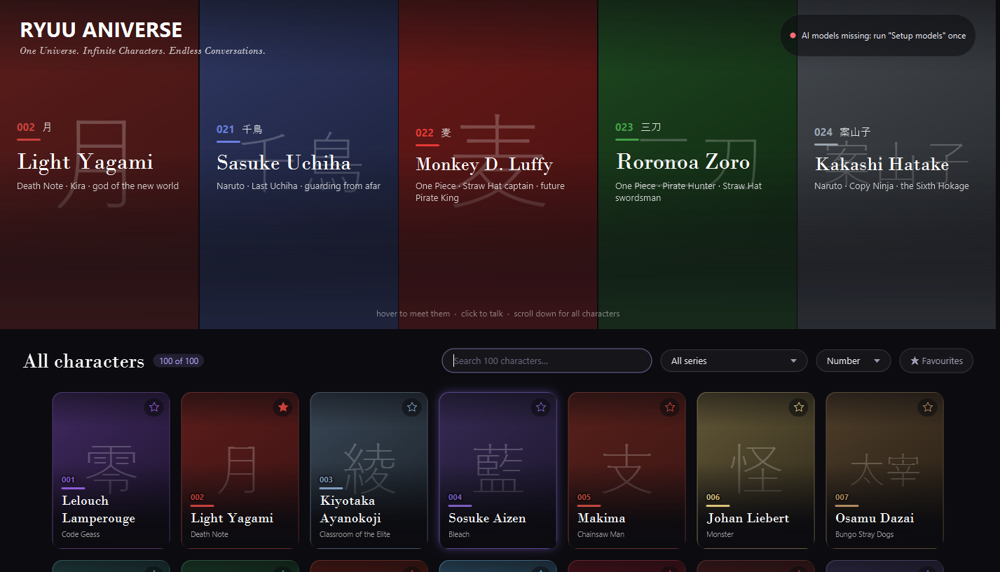
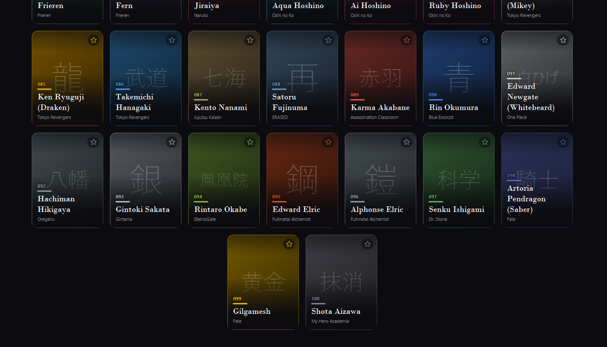
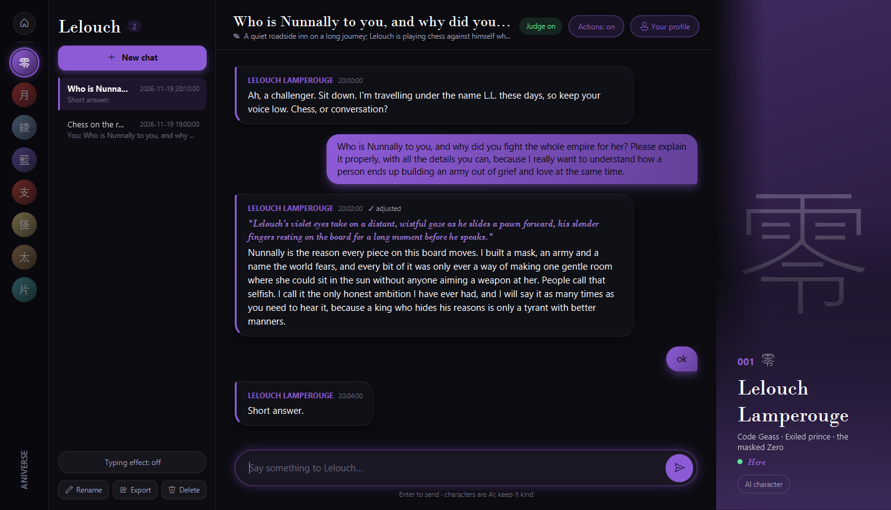

# Ryuu Aniverse

**One Universe. Infinite Characters. Endless Conversations.**

A private desktop app for Windows where you chat with **100 anime characters**. Everything runs on your own
computer with local AI models: no accounts, no cloud, nothing leaves your machine.



| Gallery | Chat | Your profile with a character |
|---|---|---|
|  |  |  |

## What it is

- **100 characters** from 41 series, each at the **end of their story** (ongoing series: the latest published arc).
  Each has a knowledge pack: personality, speech style, facts, relationships, secrets, canon events and
  fact-check lines.
- **One shared brain, many characters.** A single local model ([L3-8B-Stheno-v3.2](https://huggingface.co/Sao10K/L3-8B-Stheno-v3.2))
  becomes each character through a system prompt built from that character's pack. No fine-tuning per character.
- **A judge model** ([phi4-mini](https://ollama.com/library/phi4-mini)) checks every reply before you see it: stays in
  character, no wrong relationships or facts, no assistant-style answers, romance rules respected. A bad reply is
  rewritten up to two times, then replaced by a safe in-character line.
- **Your own profile per character** (name, a line about you, how you met), saved on your computer.
- Chat threads (new, rename, export, delete), a scene picker, optional action lines and typing effect, favourites,
  search and series filter.
- Optional portraits: drop `NNN_name.png` pictures into `assets/portraits/`. Without them each character
  gets a coloured glyph.

## Rules built in

- Characters are AI role-play, not the real series. Facts are checked but can be wrong.
- **Sweet romance only, never explicit.** Children: friendly only. Teen characters: sweet romance only with users
  under 18. Adult characters: sweet romance only with users 18+. All other combinations: friendly only.
  The app asks "Are you under 18?" once.
- If a message sounds like real danger, the character replies with a short caring note.

## Install (Windows 10/11, 64-bit)

1. Install [Ollama](https://ollama.com/download).
2. Download the latest zip from **Releases** and unpack it anywhere.
3. Double-click **Setup models.bat** (once). It installs `aniverse-judge` (phi4-mini, ~2.5 GB) and `aniverse-brain`
   (Stheno 8B Q8_0, ~8.5 GB) through Ollama. About 12 GB of free disk space is needed.
4. Start **Ryuu Aniverse v2.exe**.

Needs a computer that can run an 8B model (16 GB RAM, ideally a GPU with 8+ GB). A reply takes roughly 10-30 s.
The app runs its own private Ollama on port 11436 and stops it when you close the app; your normal Ollama is untouched.
Chats and settings are stored in `%LOCALAPPDATA%\Ryuu Aniverse`.

## Build from source

Requirements: JDK 26 and the [JavaFX SDK 26.0.1](https://openjfx.io) unpacked to `lib/javafx-sdk-26.0.1/`.

```bat
build.bat        :: compile into out\
run.bat          :: run from the project folder (dev mode: data stays in this folder)
release.bat      :: self-contained release in dist\ (exe + Java runtime + content + setup + docs + zip)
```

Dev tools (no AI needed unless noted):

```bat
py -I tools\validate_knowledge.py          :: schema + consistency checks for all packs
java ... aniverse.Main -Daniverse.shots=<dir>      :: screenshots of the screens
java ... aniverse.Main -Daniverse.dialogs=<dir>    :: click-through test of the dialogs (13 checks)
java ... aniverse.BatchCheck <report> all          :: runs test questions for every character (needs the models; ~1 hour)
```

## Project layout

| Folder | What |
|---|---|
| `src/aniverse/` | the app (JavaFX): chat engine (`TurnPipeline`, `Judge`, `WordRules`, `PromptBuilder`, `Ollama`), UI (`HomeView`, `ChatView`, `ProfileSheet`) |
| `knowledge/` | roster, 41 series sheets, 100 character packs (`.json` + readable `.md`), prompts and rules (`global/`), schemas |
| `eval/` | per-character test questions (facts, traps, in-character, safety) |
| `knowledge/image_prompts/` | a ready-to-paste portrait prompt for each character (and `standalone/` single-message versions) |
| `models/` | Ollama Modelfiles for the two models |
| `plan.md` | the full design and decision record |

## Licence and credits

- Source code: **MIT** (see `LICENSE`).
- Character knowledge packs, prompts and tests (`knowledge/`, `eval/`): **CC BY-NC 4.0**: free to use and share, not for commercial use.
- The Stheno model is **CC BY-NC 4.0** (+ Llama 3 licence), phi4-mini is MIT, JavaFX is GPL v2 + Classpath Exception.
  See `tools/release_NOTICE.txt`. **Non-commercial use only.**
- **Unofficial fan project.** All characters, names and series belong to their creators and publishers; this project is not
  affiliated with or endorsed by them. The character texts are original summaries, not copied from any source.
  Portraits are not included in this repository.
