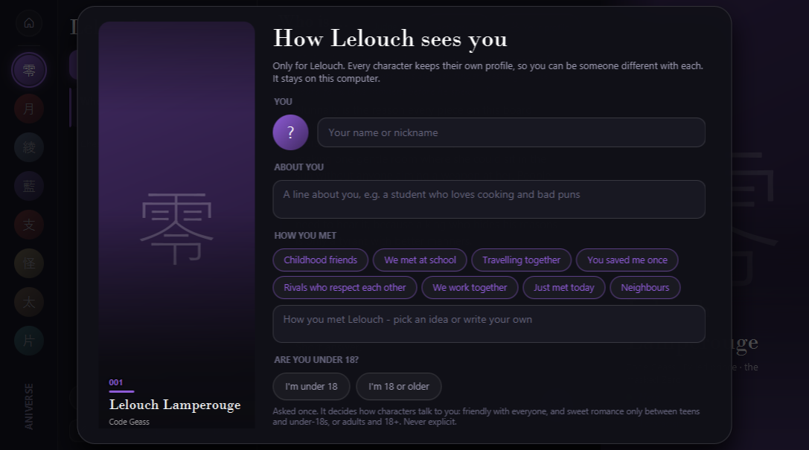

<div align="center">


# 🌌 Ryuu Aniverse

### *one universe · infinite characters · endless conversations*

**Chat with 100 anime characters from 41 series:**
**one local AI brain, a judge that checks every reply, fully offline.**

`Java 26` · `JavaFX 26.0.1` · `Ollama 0.40` · `Llama-3 8B (Stheno v3.2)` · `phi4-mini judge` · `Windows`

</div>

---

## ✨ What is this?

Ryuu Aniverse is a private desktop app for Windows where you can talk with **100 anime characters**: Lelouch, Light, Gojo, Itachi, Makima, Levi, Tanjiro and many more. Everything runs on your own computer: no accounts, no cloud, nothing leaves your machine.

- 🎭 **100 characters, 41 series.** Each one is set at the **end of their story** (ongoing series: the latest published arc), so they remember what they lived through.
- 📚 **A knowledge pack per character.** Personality, speech style, facts, relationships, secrets, canon events and fact-check lines.
- 🧠 **One shared brain.** A single local model becomes each character through a prompt built from their pack, with no fine-tuning per character.
- 🛡️ **A judge reads every reply.** In character? Right facts and relationships? No assistant talk? Romance rules respected? If not, the reply is quietly rewritten.
- 🧑 **Your own profile per character.** Your name, a line about you, and how you met.
- 🔒 **100 % offline and private.** Chats and settings stay on your computer.

<div align="center">

<br><sub>The home screen: search, filter by series, pick a character.</sub>
</div>

---

## 💬 How a reply is made

<div align="center">

<br><sub>A real test chat with Lelouch. The ✓ <i>adjusted</i> tag shows the judge sent a reply back once.</sub>
</div>

```text
 You type a message
        │
        ▼
 ① The prompt is built: the character's pack + series sheet + your profile + the scene + the rules
        │
        ▼
 ② The brain (Stheno 8B) writes the reply ───────────────────────┐
        │                                                        │ something wrong?
        ▼                                                        │ (out of character, wrong
 ③ Word rules + the judge (phi4-mini) read it ───────────────────┘  fact, AI talk, romance rule)
        │  all good                                                → rewritten up to 2 times,
        ▼                                                            else a safe in-character line
 You see:  *Lelouch slides a pawn forward…*   ← optional action line
           "Nunnally is the reason every piece on this board moves."
```

A reply takes roughly **10–30 seconds** on a laptop.

---

## 🧩 Features

| Area | What it does |
|---|---|
| **Gallery** | All 100 characters with search, series filter and favourites |
| **Chat** | Threads per character (new, rename, export, delete), a scene picker, optional action lines and typing effect |
| **Your profile** | Your name, a line about you and how you met, separate for every character |
| **Portraits** | Optional: drop `NNN_name.png` pictures into `assets/portraits/`. Without them each character gets a coloured glyph (零, 月, 綾…). A ready-to-paste portrait prompt for every character is in `knowledge/image_prompts/` |
| **Private Ollama** | The app runs its own Ollama on port 11436 and stops it when you close the app. Your normal Ollama is never touched |

| Gallery | Your profile with a character |
|---|---|
|  |  |

---

## 🛡️ Rules built in

| Rule | How it works |
|---|---|
| **It's role-play** | Characters are AI, not the real series. Facts are checked but can still be wrong |
| **Sweet romance only, never explicit** | Children: friendly only. Teen characters: sweet romance only with users under 18. Adult characters: sweet romance only with users 18+. Everything else: friendly only. The app asks *"Are you under 18?"* once |
| **Real danger** | If a message sounds like real danger, the character replies with a short caring note |

---

## 🚀 Quick start

1. **Install** [Ollama](https://ollama.com/download) (0.40 or newer).
2. **Install the two models** (once): right-click `tools\setup_models.ps1` → *Run with PowerShell*. It creates
   - `aniverse-judge`: a thin layer on phi4-mini (~2.5 GB download)
   - `aniverse-brain`: a thin layer on Stheno 8B Q8_0 (~8.5 GB download, or put your own `L3-8B-Stheno-v3.2-Q8_0.gguf` in `models\` to skip it)

   About **12 GB** of free disk space is needed. Running it again is safe.
3. **Open the app:** install the Java 26 JDK, download the [JavaFX SDK 26.0.1](https://gluonhq.com/products/javafx/) into `lib\javafx-sdk-26.0.1\`, then double-click **`run.bat`** (it builds the app the first time).
4. Pick a character and say hi. 🌌

> 💡 Needs a computer that can run an 8B model: 16 GB RAM, ideally a GPU with 8 GB or more. In the packaged app, chats and settings live in `%LOCALAPPDATA%\Ryuu Aniverse`; when run from this folder they stay here.

---

## 🗂️ Project map

```text
Ryuu_Aniverse_chatbox\
├── README.md                ← you are here
├── LICENSE                  ← copyright & terms of use (all rights reserved)
├── plan.md                  ← the full design and decision record
├── build.bat · run.bat      ← compile into out\ · run from this folder
├── package.bat · release.bat← Windows exe · self-contained release zip in dist\
├── src\aniverse\
│   ├── TurnPipeline · Judge · WordRules · PromptBuilder · Ollama   ← the chat engine
│   └── HomeView · ChatView · ProfileSheet                          ← the screens
├── knowledge\
│   ├── roster.json          ← the 100 characters
│   ├── series\              ← 41 series sheets
│   ├── characters\          ← 100 packs (.json + readable .md)
│   ├── global\              ← shared prompts and rules
│   ├── image_prompts\       ← a portrait prompt per character
│   └── schema\
├── eval\                    ← per-character test questions (facts, traps, in-character, safety)
├── models\                  ← Modelfiles for aniverse-brain and aniverse-judge
├── tools\                   ← model setup, knowledge validation, roster builders
└── docs\screenshots\
```

---

## 🛠️ For tinkerers

| I want to… | Do this |
|---|---|
| Change colours or fonts | Edit `assets\style.css`, then restart the app |
| Change the code | Edit `src\aniverse\*.java`, run `build.bat`, then `run.bat` |
| Build the Windows app | `release.bat` → exe + Java runtime + content + setup + docs + zip in `dist\` |
| Check all 100 packs | `py -I tools\validate_knowledge.py` (schema + consistency, no AI needed) |
| Screenshot every screen | Run with `-Daniverse.shots=<folder>` |
| Click-test the dialogs | Run with `-Daniverse.dialogs=<folder>` (13 checks) |
| Test every character | `java … aniverse.BatchCheck <report> all` (needs the models, about 1 hour) |

---

## 📜 Credits & licences

- **Characters:** all characters, names and series belong to their creators, publishers and studios. This is an **unofficial, non-commercial fan project**, not affiliated with or endorsed by them. The character texts are original summaries, not copied from any source. Portraits are not included in this repository.
- **Brain model:** [L3-8B-Stheno-v3.2](https://huggingface.co/Sao10K/L3-8B-Stheno-v3.2) by Sao10K, CC BY-NC 4.0, built on Meta Llama 3.
- **Judge model:** [phi4-mini](https://ollama.com/library/phi4-mini) by Microsoft, MIT licence.
- **Tools:** Ollama · OpenJFX (GPL v2 + Classpath Exception). See `tools/release_NOTICE.txt`.

---

## 📄 Copyright & Terms of Use

**© 2026 Adithya V. All Rights Reserved.**

This repository is published for portfolio, demonstration, and educational viewing purposes only. You are welcome to view the source code to understand the implementation.

**You MAY** download, install and run it on your own computer for your own **personal, non-commercial use**.

**You may NOT:**

- Copy or reproduce substantial portions of this project, including the character knowledge packs.
- Redistribute, republish, or mirror this repository.
- Use this code in commercial projects without prior written permission.
- Submit this code, or substantially similar code, as your own for academic purposes.
- Remove copyright notices or claim this work as your own.
- Share, sell or re-upload it (including copies downloaded for personal use), or change the source code and use or share the changed version.

If you would like to use any part of this project, please contact me first for permission.

The full legal terms are in the [**LICENSE**](LICENSE) file.

> Third-party parts keep their own owners and licences: the anime characters and series (their creators and publishers), the brain model L3-8B-Stheno-v3.2 (CC BY-NC 4.0), the judge model phi4-mini (MIT) and OpenJFX (GPL v2 + Classpath Exception). See **Credits & licences** above.

<div align="center">

*Every story ends. Here, the conversation doesn't.* 🌌

</div>
